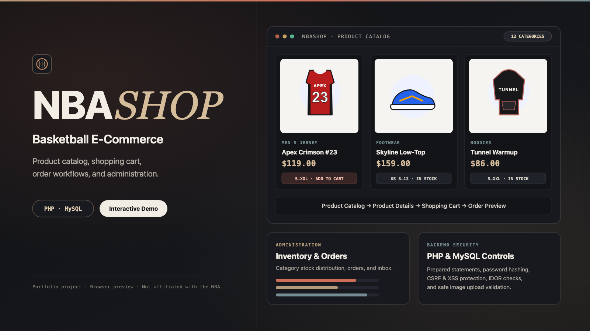

# NBASHOP



**NBASHOP** is an educational basketball e-commerce web application built with PHP and MySQL. It includes a product catalog, shopping cart, order workflows, inventory management, and an administration panel, with a focus on web application security.

This public repository provides an interactive browser preview of the original project so visitors can explore the storefront, order workflow, and administrative views without running a PHP/MySQL server.

**Live Interactive Demo:** [https://erturkeryavuz.github.io/nbashop-demo/](https://erturkeryavuz.github.io/nbashop-demo/)

## Core Features

- **Product Catalog:** Browse 12 basketball merchandise categories with keyword search, price and stock filters, multi-category selection, sorting, and pagination.
- **Product Details:** Inspect descriptions, available stock, size options, and related items inside a responsive product-detail modal.
- **Shopping Cart:** Add, adjust, or remove items with quantity controls that respect available sample inventory and automatically calculate order totals with `$10.00` flat shipping.
- **Order Workflows & Receipts:** Complete a non-payment checkout preview that generates a local order receipt (`NBA-XXXXXXXX`), updates sample inventory, and records the order for administrative review.
- **Customer Inquiries & Demo Account:** Submit storefront inquiries directly to the local admin inbox and switch between guest and signed-in demo account states.
- **Administration & Backend Security:** Review order volume, category inventory distribution, recent orders, customer inquiries, and a summary of the backend security remediations implemented in the original PHP/MySQL codebase.

## Technology Stack

- **Original Application (Private Repository):** PHP, MySQL (`mysqli` prepared statements), and Apache (historically verified in CI on PHP 8.3, MySQL 8.0, and Apache 2.4).
- **Public Browser Preview (`docs/`):** Vanilla HTML5, CSS3, JavaScript (ES6+), original inline SVG product illustrations (`docs/artwork.js`), and browser `localStorage`.
- **Typography & Layout Heritage:** `Poppins` (Google Fonts, `OFL-1.1`) and EShopper visual layout heritage adapted from HTML Codex (`CC-BY 4.0`).

## Architecture & Backend Security

The original private PHP/MySQL application underwent a focused security remediation pass across storefront and administrative endpoints:

- **SQL Injection Prevention:** Migrated storefront and admin database queries to `mysqli` prepared statements with an allowlisted `ORDER BY` map.
- **Authentication & Session Hardening:** Enforced `password_verify()`, `session_regenerate_id(true)`, and centralized admin session checks (`logged_in_check.php`) with immediate redirects on unauthorized access.
- **CSRF, XSS & Method Safety:** Added session-bound CSRF token verification, shared `e()` HTML output escaping, and `POST`-only state-changing delete handlers.
- **Invoice Access Control (IDOR):** Restricted order invoice access to administrators, owning users, or verified session tokens using `hash_equals()`.
- **Safe File Uploads:** Added authentication, CSRF checks, `finfo` / `getimagesize()` MIME verification, randomized filenames, and Apache `.htaccess` script-execution denial (`HTTP 403`).
- **Checkout Safety:** Removed raw credit card, CVC, and IBAN fields in favor of transactional order-preview recording.

These backend controls were implemented and verified in the separate private PHP/MySQL repository—they are not executed by the static GitHub Pages browser preview. A structured overview is available inside the demo under **6. Admin & Security**.

## Exploring the Demo

Open the [live demo](https://erturkeryavuz.github.io/nbashop-demo/) to browse all six views manually, or click **Watch Tutorial** in the top bar for a guided walkthrough of catalog filtering, product details, cart totals, checkout preview, order receipt, customer inquiries, the admin dashboard, and the backend security summary.

The walkthrough supports Play/Pause, Previous/Next, Restart, Replay, and reduced-motion preferences, and restores your manual browsing state automatically on exit.

## Testing & Verification

### Original Private PHP/MySQL Backend (Historical Verification)
Executed against the separate private PHP/MySQL engineering codebase in a PHP 8.3 / MySQL 8.0 / Apache 2.4 runtime environment (not executed on GitHub Pages):
- **14/14** offline static security checks.
- **17/17** CI runtime HTTP security test cases covering authentication SQLi probes, CSRF `403` enforcement, invoice IDOR `403` checks, Apache `.htaccess` upload script denial, and atomic stock rollback.

### Public Browser Preview (This Repository)
- **10/10** offline repository safety, file inventory, artwork signature/dimension, link, attribution, and JavaScript syntax checks (`tests/verify_demo.py`).
- **9/9** tutorial lifecycle, state isolation, adaptive viewport, and mobile visibility regression tests (`tests/test_tutorial.py`).

## Demo Limitations & Source Availability

- **Private Backend Source:** The original PHP/MySQL source code, database schema, and server configuration remain in a private repository. This public repository contains only the static browser preview (`docs/`), cover artwork (`media/`), third-party notices, and offline tests.
- **Browser Simulation Only:** This website is not an operating store. No real orders, payment processing, card/IBAN collection, external form transmissions, or live PHP/MySQL backend execution occur. All catalog items, inventory figures, sample orders, and demo accounts (`@example.invalid`) are synthetic.
- **Non-Affiliation:** NBASHOP is an independent educational portfolio project and is not affiliated with, endorsed by, or sponsored by the National Basketball Association (NBA), Nike, Under Armour, New Era, or any commercial sports franchise or merchandise brand.

## Attribution & Licensing

- **EShopper Visual Heritage:** Adapted from [HTML Codex](https://htmlcodex.com) under **Creative Commons Attribution 4.0 International (`CC-BY 4.0`)**, with the required credit link preserved in the storefront footer.
- **Typography:** `Poppins` loaded from Google Fonts under the **SIL Open Font License 1.1 (`OFL-1.1`)**.
- **Original Artwork:** Custom inline SVG product illustrations in `docs/artwork.js` and editable SVG cover artwork in `media/src/`.

Full notices:
- [docs/THIRD-PARTY-NOTICES.md](docs/THIRD-PARTY-NOTICES.md)
- [https://erturkeryavuz.github.io/nbashop-demo/notices.html](https://erturkeryavuz.github.io/nbashop-demo/notices.html)

## Local Preview

```bash
# Run offline safety, inventory, artwork, link, and JS syntax checks
python3 -B tests/verify_demo.py

# Run tutorial lifecycle, state isolation, and responsive regression tests
python3 -B -m unittest discover -s tests -v

# Serve the static preview locally
python3 -m http.server 8080 --directory docs
# Open http://127.0.0.1:8080/
```
